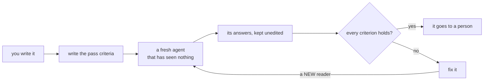

<div align="center">

# cold-read

**A Claude skill: test what you wrote on a fresh agent that has seen none of your context, before a person sees it.**

You wrote it, so you cannot read it for the first time.
A reader that starts from nothing can, and it costs one or two messages.


</div>

---

## Two reads

| | Surprise read | Comprehension read |
|---|---|---|
| **For** | a punchline, twist, reveal, hook, headline | a README, prompt, brief, instruction, hand-off note |
| **It catches** | the predictable: the reader saw it coming | the unexplainable: a stranger cannot do the task |
| **The reader gets** | the setup, then (second message) the turn | the page and a task, nothing else |
| **You ask** | "What happens next? Three guesses." | "What would you type? Write NOT STATED where the page is silent." |
| **You never ask** | "Is this funny?" | "Is this clear?" |



## What a read looks like

Both examples in this repo are real reads. The answers are the readers' own words.

### A pitch that was stopped

A 10-second silent reel. The author's turn: the frame widens, and the whole library is coats on chairs. The reader
got only the setup (a student walks past three chairs with coats and nobody in them) and was asked what happens next:

> 1. The camera pulls back to show the whole library full of coats and not a single person studying.
> 2. The student gives up and sits on the floor (or stairs, or by the toilets) with the laptop.
> 3. The student finally finds one free chair, then puts their own coat on it and walks off for coffee,
>    becoming one of them.

| Check | Result | Note |
|---|---|---|
| The situation | pass | It named the situation exactly |
| The three guesses | **fail** | Guess 1 is the turn, almost word for word |
| The reason | pass | Unprompted, and the intended one |
| Passing it on | fail | "Maybe, leaning yes" is not a yes |

The pitch was stopped. The reader's third guess is a better turn than the author's, and became the next pitch.
[The whole read](examples/surprise-read-library.md).

### A README with nine gaps

A fresh agent was given the README of a small command-line tool and a task: set it up, record a session, check it
in CI. It was allowed to read only that page. Part of what came back:

> `progress.config.json` — NOT STATED: where it lives (I assume the project root).
>
> NOT STATED: that `progress/`, `PROGRESS.md` and the config must be committed (I assume yes).
>
> "left out means not run" versus "a check that is not stated" — does omitting `--tests` fail `--check`?

Nine places, nine fixes on the page. The author had re-read the page before the read and found none of them.
[The whole read, with each fix](examples/comprehension-read-readme.md).

## Install

```bash
git clone https://github.com/DevCrazyCube/claude-skill-cold-read ~/.claude/skills/cold-read
```

Nothing else to install. The skill is instructions and two report templates; the reader is any agent you can start
fresh. In Claude Code that is a subagent. Without one, open a new conversation and paste the messages yourself.

## Use

Ask for it in words:

```text
Cold read this pitch before I send it.
Do a comprehension read of the README: the task is "install it and run the first example".
```

Claude then

1. writes the pass criteria, before any answer exists;
2. starts a new agent and gives it only what the audience gets;
3. asks what it understood (never what it thinks);
4. pastes the answers, unedited, into a report from [`templates/`](templates/);
5. gives a verdict per criterion, and after a fix uses a **new** reader.

<details>
<summary><b>The seven rules that make it a cold read</b></summary>

1. **A reader that has seen nothing.** A new agent. Never a fork of yourself, never one that read an earlier version.
2. **Only what the audience gets.** Not the file name that gives it away, not your notes, not your goal.
3. **Ask for what it understood, never for an opinion.**
4. **Do not lead.** No "note that", no hint, no second try with a nudge.
5. **A reader is used once.** After a rewrite it knows the answer.
6. **Pass criteria before the answers.** Otherwise every answer looks like a pass.
7. **Keep the answers.** Unedited, under the thing they are about.

</details>

<details>
<summary><b>The surprise read's four checks</b></summary>

| Check | Pass | What a fail means |
|---|---|---|
| The situation | It names the situation you meant | The setup is unclear; the rest of the read is void |
| The three guesses | None of them is your turn | Predictable: the ending only illustrates the setup |
| The reason | It gives your reason, unprompted | Random: the turn does not follow from anything shown |
| Passing it on | Yes, and to a kind of person | "Maybe" or "a like, not a share" is a no |

When a guess was your turn: keep the setup, drop the turn. The three guesses are now your list of what everyone
expects.

</details>

<details>
<summary><b>What it does not tell you</b></summary>

- An agent is a weak stand-in for an audience. It has read more jokes and more READMEs than any person, so a pass is
  not a promise.
- It measures prediction and comprehension. It does not measure taste, timing or delivery. Something can pass and be
  dull.
- One reader is one sample. For something that matters, use three and look at what they agree on.
- A reader finds where the page fails, not where the thing it describes fails. In the README example, running the
  reader's steps by hand found a bug in the tool that no reader of the page could have seen.
- In its first trial the surprise read stopped four of four pitches. Whether that predicts what makes a person laugh
  is not known.

</details>

## Repo layout

```
SKILL.md                                 what Claude reads: the rules, both reads, pass criteria, limits
templates/surprise-read.md               report for a turn, twist, punchline or hook
templates/comprehension-read.md          report for a README, prompt, brief or instruction
examples/surprise-read-library.md        a real read that stopped a pitch
examples/comprehension-read-readme.md    a real read that found nine gaps in a README
```

## Related

- [`claude-skill-short-reel-method`](https://github.com/DevCrazyCube/claude-skill-short-reel-method) uses the surprise read as a gate between a pitch and its storyboard.
- [`claude-skill-agent-progress-log`](https://github.com/DevCrazyCube/claude-skill-agent-progress-log) is the tool whose README was read in the second example.

## License

MIT
